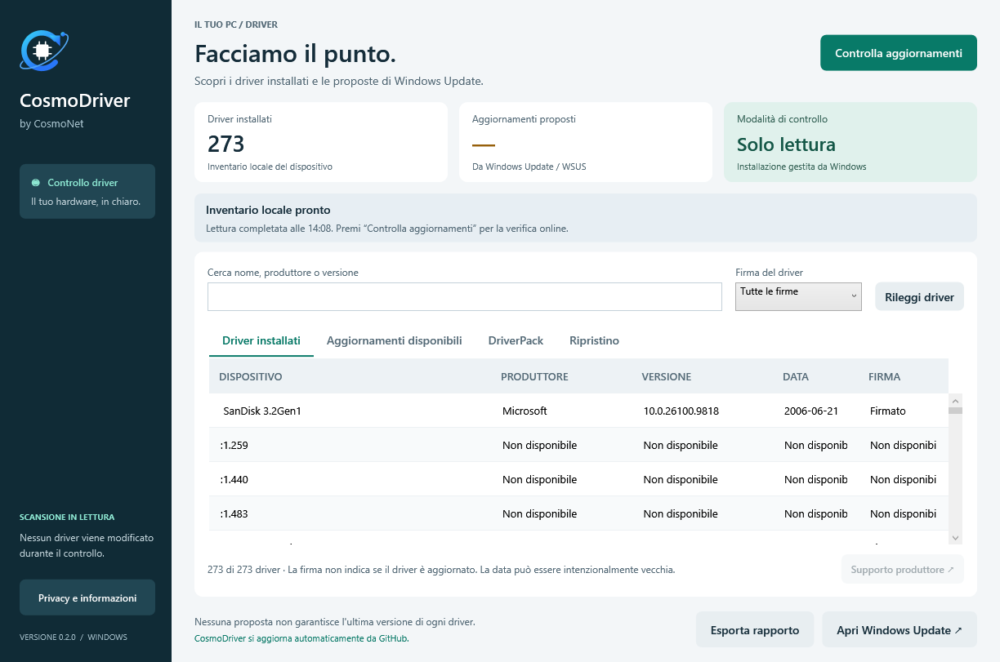

# CosmoDriver · by CosmoNet

Controlla i driver di Windows con Windows Update, pacchetti INF locali e accesso al catalogo SDIO. Nessuna modifica durante la scansione; installazioni con conferma esplicita.



## Novità 0.2.0

- **DriverPack locali:** compatibilità dei pacchetti INF verificata da Windows SetupAPI; hash dalla scansione alla copia protetta, verifica firma e installazione senza forzare driver peggiori.
- **Catalogo SDIO:** download/importazione dello ZIP ufficiale verificato, avvio del motore originale Snappy Driver Installer Origin in finestra separata per indici, pacchetti online e offline.
- **Punti di ripristino:** creazione manuale e opzione inizialmente attiva prima delle installazioni. Se richiesta e non verificata, l'installazione non parte.
- Nuovo logo originale CosmoDriver, approvato e coordinato con CosmoNet: [SVG, PNG e anteprima](docs/brand/).

Dettagli e limiti: [DriverPack, ripristino e fonti di terze parti](docs/DRIVERPACKS.md). Non è garantita la disponibilità di ogni driver del PC. Le modalità native e il motore SDIO restano chiaramente distinguibili.

## Download e utilizzo

Scarica dalla pagina [Releases](https://github.com/CosmoNetinfo/CosmoDriver/releases):

- **CosmoDriver-Setup-…-win-x64.exe**: installer per il tuo account, con disinstallazione e collegamento nel menu Start; non richiede amministratore.
- **CosmoDriver-Portable-…-win-x64.zip**: estrai e apri `CosmoDriver.exe`. Non serve installare .NET.
- **CosmoDriver.exe**: lo stesso eseguibile portatile, usato anche dall'aggiornamento automatico.

Windows x64 con API di Windows Update disponibili, Windows 11 consigliato. Minimo tecnico Windows 10 1809; il supporto del sistema operativo e di .NET dipende dal ciclo di vita Microsoft. Non sono previste build x86/ARM64 native in questa versione.

All'apertura viene letto solo l'inventario locale. **Controlla aggiornamenti** avvia anche una ricerca online tramite Windows Update Agent. Sono incluse le proposte facoltative; gli aggiornamenti nascosti restano esclusi. L'app rispetta la fonte Windows Update/WSUS e i criteri aziendali configurati: non forza servizi alternativi.

Nella scheda **Aggiornamenti disponibili**, seleziona una proposta e premi **Installa selezionato**. L'app mostra termini di licenza e conferma; solo allora richiede l'autorizzazione amministrativa di Windows. Il processo autorizzato cerca nuovamente lo stesso ID e revisione, verifica che la licenza non sia cambiata, quindi scarica e installa esclusivamente quel driver usando Windows Update Agent. Nessun riavvio viene eseguito automaticamente. Dopo un'installazione, ripeti il controllo per aggiornare i risultati. Durante l'installazione la chiusura dell'app è bloccata per evitare interruzioni; la ricerca, invece, può essere annullata. Se l'elevazione richiede credenziali di un account diverso, la connessione protetta tra processi può essere rifiutata: usa **Apri Windows Update**.

I driver di terze parti distribuiti su Windows Update sono inclusi. Per quelli disponibili esclusivamente sul sito del produttore, l'app offre **Supporto produttore** per un elenco riconosciuto di produttori (Intel, NVIDIA, AMD, Dell, HP, Lenovo, Acer e ASUS). Il pulsante apre il sito ufficiale, senza dichiarare una nuova versione disponibile e senza scaricare o eseguire installer OEM. I produttori sconosciuti non generano URL a partire dai dati WMI.

**Apri Windows Update** resta disponibile per gestire le proposte direttamente nelle impostazioni. Un driver datato o non firmato non viene classificato automaticamente come obsoleto o pericoloso. Se il servizio non risponde, il controllo viene annullato dopo cinque minuti; l'inventario ha un limite di un minuto.

## Cosa significa il risultato

L'inventario elenca i driver Plug and Play esposti da `Win32_PnPSignedDriver`, non ogni driver del kernel. Le proposte di Windows Update sono mostrate separatamente: gli ID hardware non vengono usati per inventare corrispondenze non verificabili. **Nessuna proposta** significa solo che la fonte configurata non propone aggiornamenti; sul sito del produttore possono esistere altre versioni. Un errore, un annullamento o una risposta parziale non vengono presentati come sistema aggiornato.

Ricerca per nome, produttore, classe, INF o versione; filtro per firma nell'inventario. L'esportazione JSON contiene l'intero risultato, con date separate di inventario e ricerca online, stato del controllo e limiti della copertura. Non contiene nome utente o nome del computer; nomi di dispositivi e ID hardware delle proposte possono comunque essere identificativi.

## Aggiornamenti automatici dell'app

CosmoDriver verifica le release stabili su questa repository all'avvio e ogni sei ore. Scarica una nuova versione in background, verifica un manifest con **RSA-3072/SHA-256** e la chiave pubblica incorporata, controlla SHA-256 e dimensione del file, poi lo sostituisce alla chiusura. È possibile scegliere **Riavvia e aggiorna CosmoDriver**. Nessun downgrade o release preliminare viene applicato.

L'aggiornamento funziona per installer e portatile se la cartella dell'eseguibile è scrivibile. Una chiavetta in sola lettura non permette la sostituzione. Il file `CosmoDriver.exe.previous` conserva l'eseguibile precedente: per ripristinarlo chiudi l'app e rinominalo in `CosmoDriver.exe`. Il passaggio tra versioni aggiorna il binario dell'app; il numero mostrato nella voce di disinstallazione resta quello dell'ultimo installer eseguito. Per aggiornare anche questi metadati riesegui l'installer.

L'updater usa la cartella temporanea Windows; i file di una sostituzione fallita possono rimanere in `%TEMP%\CosmoDriver-updates`. Windows può ripulirli. I dati di scansione non vengono salvati automaticamente. L'autoupdate richiede l'eseguibile **pubblicato self-contained**; una build di sviluppo non è un pacchetto distribuibile.

La firma del manifest protegge gli aggiornamenti dentro l'app. **Non è una firma Authenticode** dell'EXE: senza un certificato di firma del codice, Windows/SmartScreen può mostrare l'editore sconosciuto. Gli hash pubblicati consentono di verificare il primo download; non sostituiscono la firma del codice.

## Privacy e sicurezza

La modalità DriverPack locale legge anche i pacchetti selezionati. Il catalogo esteso scarica il pacchetto originale SDIO dal sito dell'autore, verificato tramite hash fissato nell'app; SDIO gestisce separatamente indici, DriverPack, log e traffico anche BitTorrent nella cartella scelta. La creazione di un punto di ripristino e l'installazione INF richiedono UAC. Leggi [comportamento e limiti](docs/DRIVERPACKS.md) prima dell'uso.

Nessuna telemetria, pubblicità, account o servizio residente. La lettura WMI è locale; ricerca e installazione driver usano Windows Update. Nessuna modifica ai driver durante la scansione; l'installazione richiede una conferma esplicita. Il controllo automatico dell'app contatta GitHub API e gli host di download GitHub tramite HTTPS. Nessun inventario viene inviato a CosmoNet o a GitHub. Esporta un rapporto solo se desideri salvarlo e condividilo consapevolmente.

La UI e le scansioni girano come utente corrente; solo il processo di installazione richiede UAC, dopo conferma. Il processo riceve un ID/revisione validati e l'hash dei termini accettati tramite named pipe limitata all'utente corrente. Non vengono avviati PowerShell o comandi provenienti dai dispositivi. Le scansioni hanno processi isolati, annullamento, timeout e limite alla risposta. Le risposte incomplete sono rifiutate. I pacchetti di autoupdate vengono verificati di nuovo immediatamente prima della sostituzione atomica; una copia precedente viene mantenuta.

## Sviluppo e test

Richiede SDK .NET 10 o successivo, Windows e Inno Setup 6.

```powershell
dotnet build src/CosmoDriver/CosmoDriver.csproj -c Release
dotnet run --project tests/CosmoDriver.Tests -c Release
./scripts/Build.ps1
$process = Start-Process artifacts/publish/CosmoDriver.exe -ArgumentList '--smoke', 'artifacts/smoke' -PassThru -Wait
if ($process.ExitCode) { throw 'Smoke test failed' }
```

Il test runner termina con codice non zero su fallimento; non dipende da framework o pacchetti NuGet esterni. Verifica protocollo, stati sconosciuti, date, ricerca, manifest, alterazioni di firma/hash, percorsi, dimensioni, versioni e consenso all'installazione. La modalità `--smoke` legge **WMI reale**, controlla filtri, selezione, annullamento e stati UI, e renderizza screenshot a 1240×850 e 1000×720. Non installa driver e non contatta Windows Update o GitHub. L'installazione reale di un driver va collaudata su una VM/macchina di prova con un aggiornamento disponibile e snapshot di ripristino: i test automatici non modificano i driver della macchina. Non sostituiscono una matrice di test su tutti i dispositivi Windows.

## GitHub Actions e release

Push e pull request eseguono build, test, pubblicazione self-contained, smoke test e compilazione Inno Setup. I pacchetti e le prove sono negli artifact della run; non sono release pubbliche. Le Actions sono fissate a SHA e Dependabot propone gli aggiornamenti.

Per una release: aggiorna `Directory.Build.props`, `UpdateTrust.CurrentVersion`, le etichette di versione UI e il default in `Build.ps1`; crea un tag `vX.Y.Z`. Il workflow controlla la coerenza della versione. Il secret repository **UPDATE_SIGNING_KEY** deve contenere la chiave PEM corrispondente a `src/CosmoDriver.Core/update-public.pem`. La chiave privata non deve entrare nella repository. La pubblicazione fallisce se il secret è assente o non corrisponde. Archivia una copia sicura della chiave: perderla interrompe la catena di autoupdate.

Per firmare manualmente:

```powershell
./scripts/Sign-Release.ps1 -Version 0.2.0 -PrivateKeyPath 'percorso-esterno/update-private.pem'
```

Il workflow non esegue codice delle pull request con segreti o permessi di pubblicazione. Le release vengono create solo da tag `v*` appartenenti alla cronologia di `main`.

Licenza MIT · CosmoNet.
